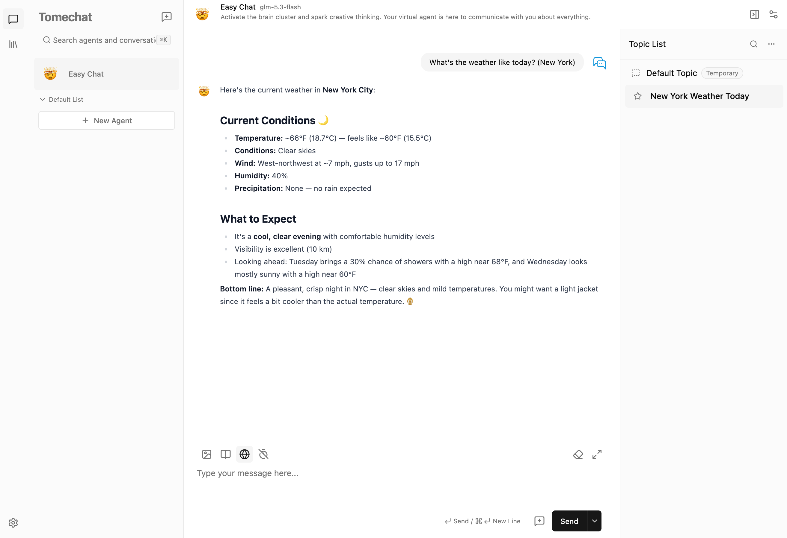

# Tomechat

RAG knowledge-base chat application built on the LangChain framework and remote LLM APIs.

[English](README.md) | [简体中文](README.zh-CN.md)

  



---

## Table of Contents

* [Overview](#overview)
* [Features](#features)
* [Quick Start](#quick-start)
    * [Install from Source](#install-from-source)
    * [Docker Deployment](#docker-deployment)
* [License](#license)

## Overview

Tomechat is a chatbot that connects to remote model services through OpenAI-compatible APIs (or the Google Gemini native SDK, via `MODEL_PLATFORM_TYPE=gemini`) and implements knowledge-base RAG (retrieval-augmented generation) chat with FAISS vector search on top of the LangChain framework.

Architecture:

- **FastAPI backend** — model proxy, RAG, knowledge-base management, database
- **Next.js frontend** — the only WebUI; talks to the backend API
- **SQLite + FAISS** — knowledge-base metadata storage and vector retrieval

Model call boundary: FastAPI is the only model gateway. The Next.js frontend never talks to model providers directly and never holds provider keys.

## Features

| Feature | Description |
|---------|-------------|
| LLM chat | Call remote LLMs through OpenAI-compatible APIs (or the Gemini native SDK) |
| Knowledge-base RAG | Local knowledge-base Q&A based on FAISS vector retrieval |
| Search engine chat | Web search–augmented chat via Tavily (or self-hosted SearxNG) |
| Knowledge-base management | CRUD, document vectorization, FAISS index |

### Model Services

Remote model services are accessed through OpenAI-compatible APIs, or through the Google native SDK for Gemini. The LLM service and the embedding service are configured independently and may use different providers (see `.env.example`):

**LLM service**

* `MODEL_API_BASE` / `MODEL_API_KEY` — provider API base URL and key
* `MODEL_CHAT_MODEL` — default chat model
* `MODEL_PLATFORM_TYPE` — `openai` (default) or `gemini` (Google native SDK; needed because Gemini 3 thinking models fail on the compatible endpoint without `thought_signature` round-trip)
* `MODEL_API_PROXY` — HTTP proxy, leave empty for direct connection

**Embedding service**

* `MODEL_EMBEDDING_MODEL` — default embedding model
* `MODEL_EMBEDDING_API_BASE` / `MODEL_EMBEDDING_API_KEY` / `MODEL_EMBEDDING_API_PROXY` — may point to a different provider; any field left unset falls back to the LLM service config

> Note: when any `MODEL_*` variable above is set, the environment config replaces the `model_settings.yaml` platform list entirely (single-platform deployment). For multi-platform setups, leave all `MODEL_*` variables unset and configure `model_settings.yaml` instead.

No local models, model weights, or GPU runtimes are deployed. Reranker and multimodal capabilities are not included.

## Quick Start

### Install from Source

#### 0. Requirements

- Python 3.10+
- Node.js 20+ (Node 22, see `frontend/.nvmrc`), pnpm
- [uv](https://docs.astral.sh/uv/)

#### 1. Install the backend

```shell
uv sync --group test
```

#### 2. Configure environment variables

```shell
# Data root directory (optional, defaults to the current directory)
export TOMECHAT_ROOT=/path/to/tomechat_data

# LLM service
export MODEL_API_KEY=your-api-key
export MODEL_API_BASE=https://api.openai.com/v1
export MODEL_CHAT_MODEL=gpt-4o-mini

# Embedding service (may use a different provider; unset MODEL_EMBEDDING_API_*
# fields fall back to the LLM service config above)
export MODEL_EMBEDDING_MODEL=text-embedding-3-small

# Optional: search engine chat (Tavily)
export TAVILY_API_KEY=your-tavily-key
```

The data directory and knowledge-base database schema are created automatically at `tomechat start` — no manual initialization needed.

#### 3. Start the backend

```shell
uv run tomechat start --api
```

#### 4. Start the frontend

```shell
cd frontend
cp .env.example .env
pnpm install
pnpm run dev
```

The frontend `.env` points to the backend at `http://localhost:7861` by default. When both services are up, open <http://localhost:3010>.

### Docker Deployment

```shell
docker compose -f docker/docker-compose.yaml build
docker compose -f docker/docker-compose.yaml up -d
```

See the [Docker deployment guide](docs/install/README_docker.md) for details.

## License

This project is open-sourced under the [MIT](LICENSE) license.
